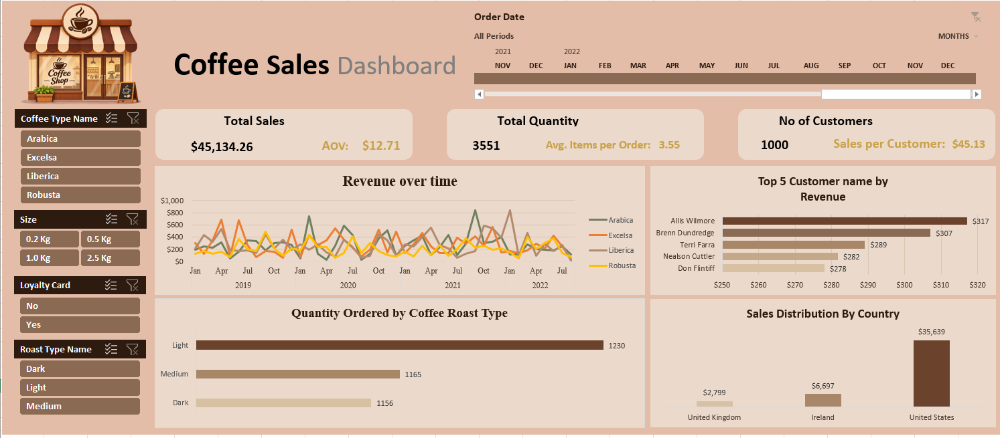

# ☕ Coffee Sales Dashboard | Microsoft Excel

An interactive sales analytics dashboard built in **Microsoft Excel** to explore coffee sales performance across time, countries, customers, coffee types, roast categories, product sizes, and loyalty-card status.

The project transforms raw transaction data into an interactive visual reporting experience, combining **PivotTables, PivotCharts, Slicers, a timeline, and KPI cards** to make business performance easier to analyze.

## 📊 Dashboard Preview

## 🎯 Business Problem

Analyzing raw transaction data manually can make it difficult to identify sales trends, compare customer performance, and understand how different product categories contribute to revenue.

This project addresses key business questions:

- How does revenue change over time?
- Which countries generate the highest sales?
- Who are the top revenue-generating customers?
- How does sales performance vary across coffee types and roast categories?
- How can product size and loyalty-card status be explored interactively?
- How can multiple sales metrics be presented in a single dashboard?

## 💡 Project Solution

Developed an interactive Excel dashboard that brings sales metrics and visual analysis together in one place.

Users can explore the data through interactive filters and date selections, making it easier to investigate sales patterns and compare different segments.

### Key Dashboard Features

**📌 KPI Cards**
- Total Sales
- Total Quantity
- Number of Customers
- Average Order Value (AOV)

**📈 Revenue Trend Analysis**
- Tracks monthly sales trends across Arabica, Excelsa, Liberica, and Robusta.
- Helps visualize fluctuations in revenue over time.

**🌍 Country-Level Sales Analysis**
- Compares sales across countries.
- Highlights the United States as the highest-sales country among the countries displayed in the dashboard.

**👥 Top 5 Customer Analysis**
- Identifies the five highest-revenue customers in the displayed results.

**☕ Coffee Roast Analysis**
- Compares quantities ordered across Dark, Light, and Medium roast categories.

**🎛️ Interactive Filtering**
- Coffee Type Name slicer
- Roast Type Name slicer
- Product Size slicer
- Loyalty Card slicer
- Order Date timeline

These controls allow users to explore different segments and time periods without manually filtering the underlying transaction data.

## 🔍 Key Insights

The dashboard supports the exploration of:

- **Revenue trends:** Monthly fluctuations across the four coffee types.
- **Geographic performance:** The United States leads among the countries shown.
- **Customer contribution:** The top five customers by revenue.
- **Product demand:** Quantity comparisons across coffee roast categories.
- **Customer segmentation:** Sales analysis by loyalty-card status.
- **Time-based performance:** Changes in results across selected dates and periods.

*Insights can change when dashboard filters or timeline selections are applied.*

## 🎨 Dashboard Design

The dashboard uses a **coffee-inspired visual theme** with warm peach backgrounds, cream-colored chart panels, and brown accents.

Design priorities include:

- Consistent KPI card styling
- Clear chart titles and readable labels
- Structured layout and spacing
- Consistent alignment across charts
- Distinct visual treatment for key metrics
- Interactive controls positioned alongside the dashboard
- A warm, coffee-themed color palette

## 🚀 What This Project Demonstrates

- Building interactive dashboards in Microsoft Excel
- Summarizing transaction data using PivotTables
- Creating PivotCharts for business reporting
- Designing KPI cards for performance monitoring
- Using slicers and timelines for interactive analysis
- Communicating business insights through visualizations
- Applying consistent formatting and dashboard design principles

## 👨‍💻 Project Focus

**Business Intelligence | Data Analytics | Excel Dashboarding**

This project demonstrates how Microsoft Excel can be used to turn transaction-level sales data into a structured, interactive dashboard for business performance analysis.
